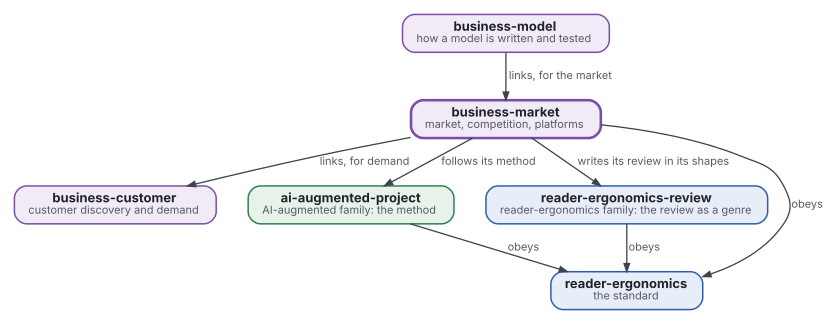
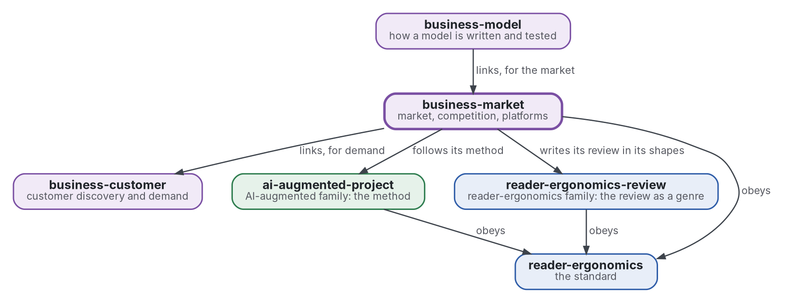

# Marché et concurrence

[](https://github.com/Tewf/business-market/actions/workflows/checks.yml)
[](https://tewf.github.io/business-market/)

La taille d'un marché, la différenciation, la concurrence, les plateformes et les marchés bifaces, et l'**économie de la personnalisation** : ce que l'adaptation d'un produit fait à un marché.

Cette page en anglais : [README.md](README.md). Les deux versions suivent le même état.

> **État (2026-11-04) :** mis en place ; rien n'est encore écrit au-delà du périmètre. Le premier travail est une revue
> de littérature, non commencée. Le nom est provisoire jusqu'à ce que la première étape de cette revue dise comment le
> domaine nomme la chose. Ce n'est ni une norme officielle, ni une étude relue par des pairs, ni un résultat nouveau.
>
> **Comment il est fait :** avec Claude, un assistant IA d'Anthropic, sous la direction du mainteneur, comme
> reader-ergonomics. Les corrections sont bienvenues sous forme d'issues.

## Où il se place



<details>
<summary>Graphviz source</summary>



</details>

- **Il lie [business-customer](https://github.com/Tewf/business-customer)** pour la preuve de la demande ; la taille d'un marché en est une estimation.
- **[business-model](https://github.com/Tewf/business-model) le lie** pour le marché ; ce dépôt ne dépend pas du modèle.
- **Sa méthode est celle d'[ai-augmented-project](https://github.com/Tewf/ai-augmented-project)** : cadrer, revoir, fixer une référence et planifier, et les registres des décisions et des valeurs provisoires. Il ne dépend pas des autres parties de ce dépôt.
- **Il écrit sa revue dans les formes de [reader-ergonomics-review](https://github.com/Tewf/reader-ergonomics-review)**, la revue comme genre ; les formes sont celles de ce dépôt.
- **Il obéit à [reader-ergonomics](https://github.com/Tewf/reader-ergonomics/blob/2e5b6f0c3e67d2dc8195a63cf882d46170e79a5a/standard.md)** (v1.21.0) et exécute ses vérifications en CI.
- **Il ne pointe que vers le bas.** La carte de la famille est [business](https://github.com/Tewf/business). Une entreprise n'apparaît ici que comme exemple, jamais comme sujet.

## Périmètre

| | Quoi | Pourquoi |
|---|---|---|
| dedans | les méthodes d'estimation de la taille d'un marché : descendante, ascendante, et l'écart entre elles | les deux divergent d'ordinaire, et la taille de l'écart dit jusqu'où se fier à l'une ou l'autre |
| dedans | la différenciation, horizontale et verticale, et ce qu'un concurrent peut copier | une différence copiable est un délai, non un fossé |
| dedans | la concurrence telle que l'économie industrielle l'énonce : entrée, rivaux et structure d'un marché | une entreprise entre sur un marché, et le domaine a un vocabulaire pour ce qu'elle y trouvera |
| dedans | les plateformes et les marchés bifaces, d'après Rochet et Tirole | une plateforme fixe le prix de deux côtés à la fois, et une règle pour l'un peut casser l'autre |
| dedans | l'économie de la personnalisation : ce que l'adaptation fait à la concurrence, aux coûts de changement et à la valeur des données | un bien personnalisé est un autre bien sur le marché, non une façon moins chère de vendre le même |
| plus tard | un modèle d'un marché nommé avec des données réelles | il faut les données et un marché à nommer, et le squelette s'en tient à la méthode |
| dehors | la demande estimée à partir des choix des clients | [business-customer](https://github.com/Tewf/business-customer) |
| dehors | un prix et la manière de le tester | [business-pricing](https://github.com/Tewf/business-pricing) |

## Le premier travail : une revue de littérature

Non commencée. Elle suit l'ordre d'une revue de thèse, et elle est finie quand elle peut nommer la référence.

1. **Cadrer :** le problème en une phrase, et comment chaque domaine le nomme. Pistes à vérifier : les manuels d'économie industrielle. Rochet et Tirole sur les marchés bifaces. L'économie de la personnalisation et de la production sur mesure en série. Les méthodes de taille de marché comme littérature grise notée selon les critères de Garousi 2019. Le dépôt peut être renommé alors.
2. **Revue :** chaque nom, cherché par son nom académique, son acronyme et son auteur ; les synthèses d'abord.
   - l'économie industrielle, d'un manuel actuel aux articles fondateurs, les synthèses d'abord ;
   - les marchés bifaces, par leurs noms académiques et leurs auteurs, avec les modèles qui donnent une règle de prix ;
   - la personnalisation comme force de marché, trouvée dans l'économie de la variété des produits et des données ;
   - les méthodes de taille de marché comme littérature grise, chaque source notée, sous le seuil un simple exemple.
3. **État de l'art, et le dossier contre.**
4. **Positionnement :** ce que ce dépôt demande et que le domaine ne répond pas déjà.
5. **Référence :** une taille de marché travaillée par deux méthodes sur un exemple posé, avec l'écart entre elles rapporté, comparée à un chiffre unique descendant, qui est la pratique.

## Questions auxquelles la revue doit répondre

- **Taille.** À quelle distance tombent les tailles descendante et ascendante, et quelles hypothèses expliquent l'écart ?
- **Fossé.** Quelles différences un concurrent peut-il copier, et que dit la littérature de ce qui dure ?
- **Plateformes.** Quand une entreprise est-elle un marché biface, et qu'est-ce que cela change à sa tarification ?
- **Personnalisation.** Que fait l'adaptation d'un produit à la rivalité et aux coûts de changement, et quelle en est la preuve ?

## Vérifier

```sh
git clone https://github.com/Tewf/reader-ergonomics
python3 reader-ergonomics/checks/run.py chemin/vers/ce/depot
```

La CI exécute les mêmes vérifications à chaque push, et une exécution échoue à la première erreur
([checks.yml](https://github.com/Tewf/business-market/blob/master/.github/workflows/checks.yml)). Chaque push sur
master construit aussi le site, [tewf.github.io/business-market](https://tewf.github.io/business-market/)
([pages.yml](https://github.com/Tewf/business-market/blob/master/.github/workflows/pages.yml)).

## Contenu

| Partie | Résumé |
|---|---|
| [decisions](decisions/) | une fiche par choix qui façonne ce dépôt, chacune ouvrant sur la décision en une phrase |

## Licence

Code sous [Apache License 2.0](LICENSE) ; prose sous [CC BY 4.0](LICENSES/CC-BY-4.0.txt). Réutilisez-le comme vous le
souhaitez, en créditant ce dépôt ; [CITATION.cff](CITATION.cff) donne une citation si besoin.
