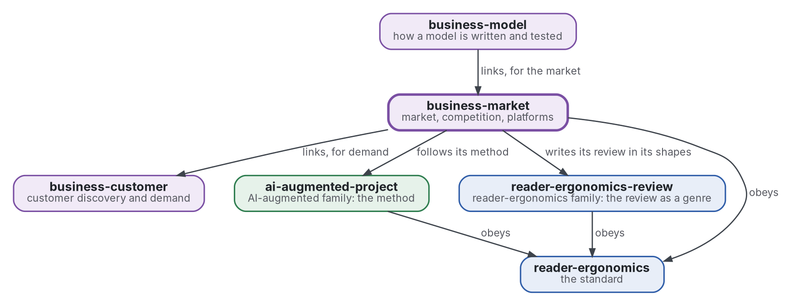

# Marché et concurrence

[](https://github.com/Tewf/business-market/actions/workflows/checks.yml)
[](https://tewf.github.io/business-market/)

La taille d'un marché, la différenciation, la concurrence, les plateformes et les marchés bifaces, et l'**économie de la personnalisation** : ce que l'adaptation d'un produit fait à un marché.

Cette page en anglais : [README.md](README.md). Les deux versions suivent le même état.

> **État (2026-11-04) :** la première revue est écrite, en première passe de 40 sources, et finit sur une référence
> nommée, B1. Un programme calcule une taille de marché ascendante sous forme d'intervalle, chaque entrée étant marquée
> PROVISIONAL. Le nom est conservé après l'étape de cadrage
> ([fiche 0002](decisions/0002-keep-the-name-and-size-a-market-by-two-methods.md)).
> Ce n'est ni une norme officielle, ni une étude relue par des pairs, ni un résultat nouveau.
>
> **Comment il est fait :** avec Claude, un assistant IA d'Anthropic, sous la direction du mainteneur, comme
> reader-ergonomics. Les corrections sont bienvenues sous forme d'issues.

## Où il se place


<details>
<summary>Graphviz source</summary>



</details>

- **Il lie [business-customer](https://github.com/Tewf/business-customer)** pour la preuve de la demande ; la taille d'un marché en est une estimation.
- **[business-model](https://github.com/Tewf/business-model) le lie** pour le marché ; ce dépôt ne dépend pas du modèle.
- **Sa méthode est celle d'[ai-augmented-project](https://github.com/Tewf/ai-augmented-project)** : cadrer, revoir, fixer une référence et planifier, et les registres des décisions et des valeurs provisoires. Il ne dépend pas des autres parties de ce dépôt.
- **Il écrit sa revue dans les formes de [reader-ergonomics-review](https://github.com/Tewf/reader-ergonomics-review)**, la revue comme genre ; les formes sont celles de ce dépôt.
- **Il obéit à [reader-ergonomics](https://github.com/Tewf/reader-ergonomics/blob/2e5b6f0c3e67d2dc8195a63cf882d46170e79a5a/standard.md)** (v1.21.0) et exécute ses vérifications en CI.
- **Il ne pointe que vers le bas.** La carte de la famille est [business](https://github.com/Tewf/business). Une entreprise n'apparaît ici que comme exemple, jamais comme sujet.

## Périmètre

| | Quoi | Pourquoi |
|---|---|---|
| dedans | les méthodes d'estimation de la taille d'un marché : descendante, ascendante, et l'écart entre elles | les deux divergent d'ordinaire, et la taille de l'écart dit jusqu'où se fier à l'une ou l'autre |
| dedans | la différenciation, horizontale et verticale, et ce qu'un concurrent peut copier | une différence copiable est un délai, non un fossé |
| dedans | la concurrence telle que l'économie industrielle l'énonce : entrée, rivaux et structure d'un marché | une entreprise entre sur un marché, et le domaine a un vocabulaire pour ce qu'elle y trouvera |
| dedans | les plateformes et les marchés bifaces, d'après Rochet et Tirole | une plateforme fixe le prix de deux côtés à la fois, et une règle pour l'un peut casser l'autre |
| dedans | un programme qui dimensionne un marché par le bas sous forme d'intervalle | une taille dont le doute n'est pas dit ne se compare à aucune autre |
| dedans | l'économie de la personnalisation : ce que l'adaptation fait à la concurrence, aux coûts de changement et à la valeur des données | un bien personnalisé est un autre bien sur le marché, non une façon moins chère de vendre le même |
| plus tard | un modèle d'un marché nommé avec des données réelles | il faut les données et un marché à nommer, et le squelette s'en tient à la méthode |
| dehors | la demande estimée à partir des choix des clients | [business-customer](https://github.com/Tewf/business-customer) |
| dehors | un prix et la manière de le tester | [business-pricing](https://github.com/Tewf/business-pricing) |

## Le premier travail : une revue de littérature

Faite en première passe le 2026-11-04, en cinq étapes d'une revue de thèse : [evidence/market-structure](evidence/market-structure/README.md). Elle réunit 40 sources, 32 formelles et 8 grises, et la plupart des chiffres sont lus dans des résumés et marqués comme tels.

## Ce que la revue a trouvé

- **Les noms du domaine sont l'économie industrielle, pour la structure et l'entrée, et la prévision, pour la taille.** La pratique dit marché adressable total et fossé. Le nom « marché » correspond en partie et reste.
- **Deux tailles d'une même entreprise tombent à 25 fois d'écart sur une seule prémisse.**
  - Un article de 2014 additionne les recettes des taxis à 100 milliards et retient une part de 10 % : environ 10 milliards (Damodaran 2014, article lu).
  - Un autre multiplie ce marché par 3 à 6 et ajoute une part du coût de possession d'une voiture : 450 milliards à 1,3 billion (Gurley 2014, article lu).
  - La prémisse est de savoir si le produit agrandit le marché. Aucune étude reliant un écart à une vente ultérieure n'a été trouvée.
  - Sur des séries de ventes, une répartition selon les proportions prévues et une combinaison optimale des niveaux battent les méthodes simples (Athanasopoulos 2009, secondaire).
  - Un plafond ajusté sur des ventes précoces est biaisé (Van den Bulte 1997, secondaire), et les intervalles déclarés sont trop étroits (Soll 2004, secondaire).
- **L'industrie explique une minorité de ce qui fait différer les rendements.** Environ 19 % de la variance tient à l'industrie et 32 % à l'activité dans un découpage (McGahan 1997, secondaire). Un autre trouve de petits effets d'industrie stables (Rumelt 1991, secondaire). Environ la moitié des établissements nouveaux survivent cinq ans (Mauboussin 2016, lu).
- **Une entreprise est un marché biface quand un intermédiaire sépare deux groupes qui s'influencent** (Rysman 2009, secondaire). Les magazines allemands subventionnent les lecteurs et tirent l'essentiel de leurs recettes des annonceurs (Kaiser 2006, secondaire). Ce que le modèle standard implique dépend de la façon dont les utilisateurs diffèrent (Weyl 2010, secondaire).
- **L'adaptation ajoute demande et coûts, et peut éroder la différence.** La variété des libraires en ligne a ajouté 731 millions à 1,03 milliard de dollars de bien-être en 2000 (Brynjolfsson 2003, secondaire). L'effet moyen d'un plus grand choix sur la décision est pratiquement nul (Scheibehenne 2010, secondaire). Les entreprises qui accordent chaîne logistique et type de variété font mieux (Randall 2001, secondaire). Exploiter les historiques d'achat peut éroder la différenciation (Zhang 2011p, secondaire). Aucune étude de terrain sur la personnalisation et la rivalité n'a été trouvée.

## La référence

**B1** est un marché dimensionné par deux méthodes avec intervalles, et un cadre de concurrence en quatre questions ([référence](evidence/market-structure/baseline.md)).

- une taille ascendante par segments et une taille descendante à partir d'un marché publié et d'une part, chaque entrée étant un intervalle marqué PROVISIONAL, calculées par `checks/local/market_size.py` ;
- l'écart entre les deux rapporté, et la prémisse qui l'explique nommée ;
- quatre questions sur la concurrence : le nombre de rivaux, le coût de copier une différence, le coût de changer, et si l'entreprise est biface.

Il lui manque une erreur mesurée, des poids pour combiner les deux tailles, et le côté coût de la variété.

## Questions auxquelles la revue a répondu

- **Taille.** À quelle distance tombent les tailles descendante et ascendante, et quelles hypothèses expliquent l'écart ?
- **Fossé.** Quelles différences un concurrent peut-il copier, et que dit la littérature de ce qui dure ?
- **Plateformes.** Quand une entreprise est-elle un marché biface, et qu'est-ce que cela change à sa tarification ?
- **Personnalisation.** Que fait l'adaptation d'un produit à la rivalité et aux coûts de changement, et quelle en est la preuve ?

## Vérifier

```sh
git clone https://github.com/Tewf/reader-ergonomics
python3 reader-ergonomics/checks/run.py chemin/vers/ce/depot
```

La CI exécute les mêmes vérifications à chaque push, et une exécution échoue à la première erreur
([checks.yml](https://github.com/Tewf/business-market/blob/master/.github/workflows/checks.yml)). Chaque push sur
master construit aussi le site, [tewf.github.io/business-market](https://tewf.github.io/business-market/)
([pages.yml](https://github.com/Tewf/business-market/blob/master/.github/workflows/pages.yml)).

## Contenu

| Partie | Résumé |
|---|---|
| [evidence](evidence/) | la première revue, sur la structure de marché : cinq étapes, 40 sources, une référence nommée |
| [decisions](decisions/) | une fiche par choix qui façonne ce dépôt, chacune ouvrant sur la décision en une phrase |
| [checks/local](checks/local/market_size.py) | un programme qui dimensionne un marché par le bas sous forme d'intervalle et place une taille descendante à côté, avec ses tests |

## Licence

Code sous [Apache License 2.0](LICENSE) ; prose sous [CC BY 4.0](LICENSES/CC-BY-4.0.txt). Réutilisez-le comme vous le
souhaitez, en créditant ce dépôt ; [CITATION.cff](CITATION.cff) donne une citation si besoin.
