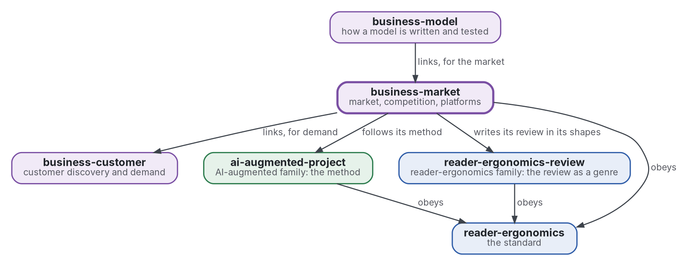

# Market and competition

[](https://github.com/Tewf/business-market/actions/workflows/checks.yml)
[](https://tewf.github.io/business-market/)

Market sizing, differentiation, competition, platforms and two-sided markets, and the **economics of personalisation**: what tailoring a product does to a market.

This page in French: [README.fr.md](README.fr.md).

> **Status (2026-11-04):** the first review is written, as a first pass of 40 sources, and ends on a named baseline,
> B1. A program computes a bottom-up market size as an interval, with every input tagged PROVISIONAL. The name is kept
> after the frame step ([record 0002](decisions/0002-keep-the-name-and-size-a-market-by-two-methods.md)).
> It is not an official standard, not a peer-reviewed study and not a new result.
>
> **How it is made:** with Claude, an AI assistant by Anthropic, under the maintainer's direction, the way
> reader-ergonomics was made. Corrections are welcome as issues.

## Where it sits


<details>
<summary>Graphviz source</summary>



</details>

- **It links [business-customer](https://github.com/Tewf/business-customer)** for demand evidence; the size of a market is an estimate from it.
- **[business-model](https://github.com/Tewf/business-model) links it** for the market; this repository does not depend on the model.
- **Its method is [ai-augmented-project](https://github.com/Tewf/ai-augmented-project)'s**: scope, review, baseline and plan, and the registers of decisions and of provisional values. It does not depend on that repository's other parts.
- **It writes its review in the shapes of [reader-ergonomics-review](https://github.com/Tewf/reader-ergonomics-review)**, the review as a genre; the shapes are that repository's.
- **It obeys [reader-ergonomics](https://github.com/Tewf/reader-ergonomics/blob/65e42472e2d4cbfd994c2a86e95a47e5dc7301ca/standard.md)** (v1.24.2) and runs its checks in CI.
- **It links down only.** The family's map is [business](https://github.com/Tewf/business). A venture appears here as an example, never as the subject.

## Scope

| | What | Why |
|---|---|---|
| in | market sizing methods: top-down, bottom-up, and the gap between them | the two usually disagree, and the size of the gap says how far to trust either |
| in | differentiation, horizontal and vertical, and what a rival can copy | a difference that can be copied is a delay, not a moat |
| in | competition as industrial organisation states it: entry, rivals and the structure of a market | a venture enters a market, and the field has a vocabulary for what it will find there |
| in | platforms and two-sided markets, after Rochet and Tirole | a platform prices two sides at once, and a rule for one side can break the other |
| in | the economics of personalisation: what tailoring does to competition, switching costs and the value of data | a personalised good is a different good in the market, not a cheaper way to sell the same one |
| in | a program that sizes a market bottom-up as an interval | a size with no stated doubt cannot be compared with another |
| later | a model of one named market with real data | it needs the data and a market to name, and the skeleton keeps to method |
| out | demand estimated from customers' choices | [business-customer](https://github.com/Tewf/business-customer) |
| out | a price and how it is tested | [business-pricing](https://github.com/Tewf/business-pricing) |

## The first job: a literature review

Done as a first pass on 2026-11-04, in the five steps of a thesis review: [evidence/market-structure](evidence/market-structure/README.md). It holds 40 sources, 32 formal and 8 grey, and most figures are read from abstracts and marked.

## What the review found

- **The field's names are industrial organisation, for structure and entry, and forecasting, for size.** Practice says total addressable market and moat. The name "market" matches in part and is kept.
- **Two sizes of one company fell 25 times apart on a single premise.**
  - One 2014 post sums taxi revenue to 100 billion and takes a 10% share: about 10 billion (Damodaran 2014, post read).
  - Another multiplies that market by 3 to 6 and adds a share of car-ownership cost: 450 billion to 1.3 trillion (Gurley 2014, post read).
  - The premise is whether the product expands the market. No study relating a gap to a later sale was found.
  - On series of sales, a split by forecast proportions and an optimal combination of levels beat the simple methods (Athanasopoulos 2009, secondary).
  - A ceiling fitted to early sales is biased (Van den Bulte 1997, secondary), and stated intervals are too narrow (Soll 2004, secondary).
- **Industry explains a minority of what makes returns differ.** About 19% of the variance is industry and 32% business-specific in one split (McGahan 1997, secondary); another finds small stable industry effects (Rumelt 1991, secondary). About half of new establishments survive five years (Mauboussin 2016, read).
- **A venture is a two-sided market when an intermediary sits between two groups that affect each other** (Rysman 2009, secondary). German magazines subsidise readers and take most revenue from advertisers (Kaiser 2006, secondary). What the standard model implies depends on how users differ (Weyl 2010, secondary).
- **Tailoring adds demand and costs, and may erode difference.** Variety at online booksellers added 731 million to 1.03 billion dollars of welfare in 2000 (Brynjolfsson 2003, secondary). The mean effect of more options on choice is virtually zero (Scheibehenne 2010, secondary). Firms that match supply chain to the kind of variety do better (Randall 2001, secondary). Using purchase histories can erode differentiation (Zhang 2011p, secondary). No field study of personalisation and rivalry was found.

## The baseline

**B1** is a market sized by two methods with intervals, and a competition frame of four questions ([baseline](evidence/market-structure/baseline.md)).

- a bottom-up size from segments, and a top-down size from a published market and a share, every input an interval tagged PROVISIONAL, computed by `checks/local/market_size.py`;
- the gap between them reported, and the premise behind it named;
- four questions on the competition: the number of rivals, the cost of copying a difference, the cost of switching, and whether the venture is two-sided.

It lacks a measured error, weights to combine the two sizes, and the cost side of variety.

## Questions the review answered

- **Sizing.** How far apart do top-down and bottom-up sizes fall, and which assumptions explain the gap?
- **Moat.** Which differences can a rival copy, and what does the literature say lasts?
- **Platforms.** When is a venture a two-sided market, and what does that change in how it prices?
- **Personalisation.** What does tailoring a product do to rivalry and to switching costs, and what is the evidence?

## Check it

```sh
git clone https://github.com/Tewf/reader-ergonomics
python3 reader-ergonomics/checks/run.py path/to/this/repository
```

CI runs the same checks on every push, and a run fails on any error
([checks.yml](https://github.com/Tewf/business-market/blob/master/.github/workflows/checks.yml)). Every push to
master also renders the site, [tewf.github.io/business-market](https://tewf.github.io/business-market/)
([pages.yml](https://github.com/Tewf/business-market/blob/master/.github/workflows/pages.yml)).

## Contents

| Part | Summary |
|---|---|
| [evidence](evidence/) | the first review, on market structure: five steps, 40 sources, a named baseline |
| [decisions](decisions/) | one record per choice that shapes this repository, each opening with the decision in one sentence |
| [checks/local](checks/local/market_size.py) | a program that sizes a market bottom-up as an interval and sets a top-down size beside it, with tests |

## Licence

Code under the [Apache License 2.0](LICENSE); prose under [CC BY 4.0](LICENSES/CC-BY-4.0.txt). Reuse it as you wish,
with credit to this repository; [CITATION.cff](CITATION.cff) gives a citation if you need one.
