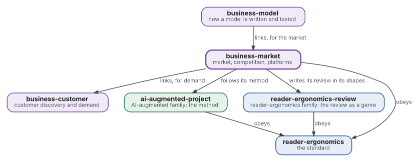
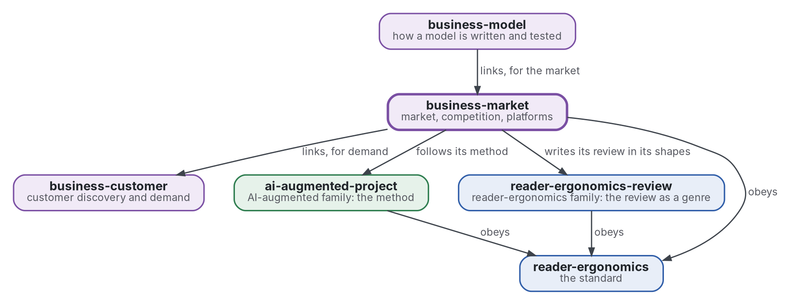

# Market and competition

[](https://github.com/Tewf/business-market/actions/workflows/checks.yml)
[](https://tewf.github.io/business-market/)

Market sizing, differentiation, competition, platforms and two-sided markets, and the **economics of personalisation**: what tailoring a product does to a market.

This page in French: [README.fr.md](README.fr.md).

> **Status (2026-11-04):** set up; nothing is written yet beyond the scope. The first job is a literature review, not
> started. The name is provisional until that review's first step says what the field calls this. It is not an
> official standard, not a peer-reviewed study and not a new result.
>
> **How it is made:** with Claude, an AI assistant by Anthropic, under the maintainer's direction, the way
> reader-ergonomics was made. Corrections are welcome as issues.

## Where it sits



<details>
<summary>Graphviz source</summary>



</details>

- **It links [business-customer](https://github.com/Tewf/business-customer)** for demand evidence; the size of a market is an estimate from it.
- **[business-model](https://github.com/Tewf/business-model) links it** for the market; this repository does not depend on the model.
- **Its method is [ai-augmented-project](https://github.com/Tewf/ai-augmented-project)'s**: scope, review, baseline and plan, and the registers of decisions and of provisional values. It does not depend on that repository's other parts.
- **It writes its review in the shapes of [reader-ergonomics-review](https://github.com/Tewf/reader-ergonomics-review)**, the review as a genre; the shapes are that repository's.
- **It obeys [reader-ergonomics](https://github.com/Tewf/reader-ergonomics/blob/2e5b6f0c3e67d2dc8195a63cf882d46170e79a5a/standard.md)** (v1.21.0) and runs its checks in CI.
- **It links down only.** The family's map is [business](https://github.com/Tewf/business). A venture appears here as an example, never as the subject.

## Scope

| | What | Why |
|---|---|---|
| in | market sizing methods: top-down, bottom-up, and the gap between them | the two usually disagree, and the size of the gap says how far to trust either |
| in | differentiation, horizontal and vertical, and what a rival can copy | a difference that can be copied is a delay, not a moat |
| in | competition as industrial organisation states it: entry, rivals and the structure of a market | a venture enters a market, and the field has a vocabulary for what it will find there |
| in | platforms and two-sided markets, after Rochet and Tirole | a platform prices two sides at once, and a rule for one side can break the other |
| in | the economics of personalisation: what tailoring does to competition, switching costs and the value of data | a personalised good is a different good in the market, not a cheaper way to sell the same one |
| later | a model of one named market with real data | it needs the data and a market to name, and the skeleton keeps to method |
| out | demand estimated from customers' choices | [business-customer](https://github.com/Tewf/business-customer) |
| out | a price and how it is tested | [business-pricing](https://github.com/Tewf/business-pricing) |

## The first job: a literature review

Not started. It follows the order of a thesis review, and it is finished when it can name the baseline.

1. **Frame:** the problem in one sentence, and what each field calls it. Leads to verify: industrial organisation texts, Rochet and Tirole on two-sided markets, the economics of personalisation and mass customisation, and market sizing methods as grey literature scored on Garousi 2019's criteria. The repository may be renamed then.
2. **Review:** each name, searched by its academic name, its acronym and its author; surveys first.
   - industrial organisation, from a current textbook to the seminal papers, surveys first;
   - two-sided markets, by their academic names and their authors, with the models that give a pricing rule;
   - personalisation as a market force, found in the economics of product variety and of data;
   - market sizing methods as grey literature, each source scored, below the threshold an example only.
3. **State of the art, and the case against.**
4. **Position:** what this repository asks that the field does not already answer.
5. **Baseline:** a worked market size by two methods on one stated example, with the gap between them reported, compared with a single top-down figure as the practice.

## Questions the review must answer

- **Sizing.** How far apart do top-down and bottom-up sizes fall, and which assumptions explain the gap?
- **Moat.** Which differences can a rival copy, and what does the literature say lasts?
- **Platforms.** When is a venture a two-sided market, and what does that change in how it prices?
- **Personalisation.** What does tailoring a product do to rivalry and to switching costs, and what is the evidence?

## Check it

```sh
git clone https://github.com/Tewf/reader-ergonomics
python3 reader-ergonomics/checks/run.py path/to/this/repository
```

CI runs the same checks on every push, and a run fails on any error
([checks.yml](https://github.com/Tewf/business-market/blob/master/.github/workflows/checks.yml)). Every push to
master also renders the site, [tewf.github.io/business-market](https://tewf.github.io/business-market/)
([pages.yml](https://github.com/Tewf/business-market/blob/master/.github/workflows/pages.yml)).

## Contents

| Part | Summary |
|---|---|
| [decisions](decisions/) | one record per choice that shapes this repository, each opening with the decision in one sentence |

## Licence

Code under the [Apache License 2.0](LICENSE); prose under [CC BY 4.0](LICENSES/CC-BY-4.0.txt). Reuse it as you wish,
with credit to this repository; [CITATION.cff](CITATION.cff) gives a citation if you need one.
