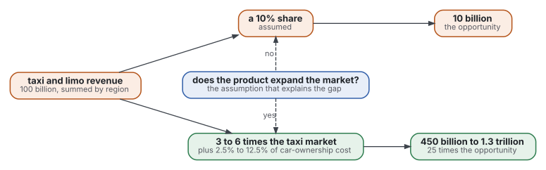
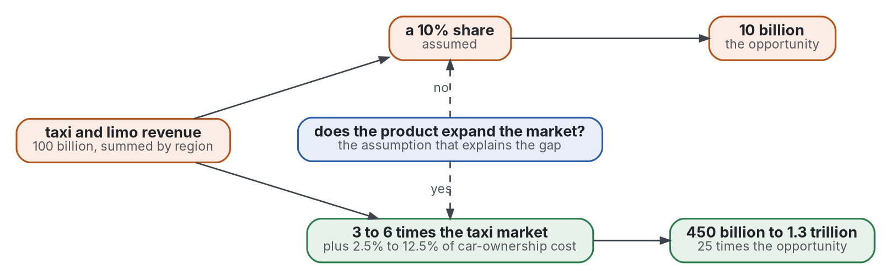

# Review: five strands

Step 2 of the review, read on 2026-11-04. It groups the 40 sources by strand and answers Q1 to Q4 of [frame](frame.md). Surveys first in each strand.

**Shape:** [review](https://github.com/Tewf/reader-ergonomics-review/blob/c43f2770000a9af5c2aa3cbc6f997da7a7e13b34/shapes/review.md)

- Each key is in the [bibliography](../bibliography.md); terms are in the [front page](../../README.md).
- Grades are the standard's four.
- A figure read in an abstract is marked (secondary).

Graphviz source

## Strand 0: existing reviews

- Two-sided markets: Rysman 2009 states two conditions, an intermediary between two sets of agents and an externality from each set to the other (abstract, secondary). Supported with caveat.
- Evans 2003p surveyed businesses in these industries: they devise entry strategies to get several sides on board (abstract, secondary). Supported with caveat.
- Entry, switching costs, mass customization and the economics of privacy each have a survey: Geroski 1995, Klemperer 1995, Silveira 2001 and Fogliatto 2012, and Acquisti 2016. Their findings were not read (located only).
- Choice overload: the mean effect over 50 experiments, 63 conditions and 5,036 people is virtually zero, with large variance between studies (Scheibehenne 2010, abstract, secondary). Measured.
- Chernev 2015 reviews the same question; its result was not read (located only).
- No review of the error of a market size, top-down or bottom-up, was found (protocol, F26, F27).

## Strand 1: sizing a market (Q1)

- The same company was sized twice in 2014. One post sums taxi and limo revenue by region to 100 billion, assumes 6% yearly growth and a 10% share, and reaches about 10 billion of opportunity (Damodaran 2014, post read). Convention, untested.
- The other post multiplies the taxi market by 3 to 6. It adds 2.5% to 12.5% of a 6 trillion car-ownership cost. The total is 450 billion to 1.3 trillion, 25 times the first (Gurley 2014, post read). Convention, untested.
- The gap is one assumption: whether the product expands the market. The arithmetic of each is sound; the posts differ on the premise (Gurley 2014, post read).
- On series of sales, a top-down method that splits by forecast proportions and an optimal combination of levels did best of five, bottom-up included (Athanasopoulos 2009, abstract, secondary). Measured, on existing series.
- Hyndman 2011 forecasts every level and reconciles them by regression (located only). Dangerfield 1992 compared the two on more than 15,000 aggregate series from a forecasting competition (Dangerfield 1992, search summary, secondary); its result was not read.
- A market ceiling fitted to early sales is biased even with a correct model (Van den Bulte 1997, abstract, secondary). The bias grows with noise and with the distance of the last observation from the ceiling. Measured, in simulation and on six innovations.
- Splitting a quantity into parts improved accuracy on nine problems with extreme, uncertain targets and not on six others; a second test with 10 problems and 280 people agreed (MacGregor 1994, abstract, secondary). Measured.
- Stated intervals missed the answer far more often than their stated confidence allows, and the miss depends on how the interval is asked (Soll 2004, abstract, secondary). Measured.
- Of 385 failed venture-backed companies with a known reason, 43% named poor product-market fit; self-reported by one producer (CB Insights 2026, page read). Measured, descriptive.

## Strand 2: competition and what lasts (Q2)

- The frame is a textbook and a model: market structure, entry and differentiation (Tirole 1988; Aspremont 1979). Convention (located only).
- In isolated local markets, competitive conduct changes quickly as the number of incumbents grows; the paper's device is an entry threshold, the market size that just supports one more firm (Bresnahan 1991, abstract, secondary). Measured.
- Industry explains little that is stable: negligible corporate effects, small stable industry effects and very large stable business-unit effects (Rumelt 1991, abstract, secondary). Measured.
- Another split gives about 2% to the year, 19% to the industry, 4% to the corporate parent and 32% to the business (McGahan 1997, abstract, secondary). The industry share is larger in services and trade than in manufacturing. Measured.
- Causal ambiguity is argued to be a barrier to imitation (Reed 1990, located only). Convention.
- About half of new establishments survive five years, and about 80% survive one (Mauboussin 2016, Exhibit 15, read). Measured, descriptive.
- High returns with heavy investment signal an opportunity to rivals and fade faster (Mauboussin 2016, page 5, read). Brands confer no advantage alone (page 2).
- Sustained advantage comes from small advantages added together, as Wiggins and Ruefli found (Mauboussin 2016, footnote 4, read). Convention, a synthesis by a bank.
- Skilful companies in one study competed on differentiators other than price and put revenue before cost (Mauboussin 2016, Raynor and Ahmed, read). Supported with caveat.
- Switching costs soften competition, the subject of an overview (Klemperer 1995, located only).

## Strand 3: platforms and two-sided markets (Q3)

- A platform must get both sides on board; the model gives the allocation of prices and of end-user surplus, for profit-maximising and not-for-profit platforms, against a monopolist and a planner (Rochet 2003, abstract, secondary). Convention, argued from a model.
- The test of a two-sided market is Rysman 2009's two conditions in strand 0; ad-funded media are the case where one side dislikes the other's presence.
- What the Rochet and Tirole model implies turns on how users differ; with differences in income or scale the content changes (Weyl 2010, abstract, secondary). Convention, argued from a model.
- Armstrong 2006 and Hagiu 2015 model competition between platforms and the choice of what a platform does itself (located only).
- In German magazines, reader prices are subsidised and most revenue comes from advertisers, who value readers more than readers value ads (Kaiser 2006, abstract, secondary). Measured.
- Practice says two-sided networks often return more at scale than a value chain, with examples and no figures (Eisenmann 2006, opening read). An example of practice only.

## Strand 4: the economics of personalisation (Q4)

- Wider choice has a demand value: the larger range at online booksellers raised consumer welfare by about 731 million to 1.03 billion dollars in 2000 (Brynjolfsson 2003, abstract, secondary). Measured.
- The cost side has two parts: production cost per variant, and the market mediation cost of inventory and lost sales (Randall 2001, abstract, secondary). Firms that match their supply chain to the kind of variety outperform those that do not. Measured.
- Competitive exploitation of purchase histories damages differentiation; a second peril comes when firms keep their data uninformative and drift to mainstream designs (Zhang 2011p, abstract, secondary). Convention, argued from a model.
- Some recommenders reduce sales diversity; individual diversity can rise while aggregate diversity falls (Fleder 2009, abstract, secondary). Convention, argued from a model and a simulation.
- Switching costs and the value of data are the subjects of Klemperer 1995 and Acquisti 2016 (located only).
- The premium for a self-designed good, and the law on personalised prices, are in [business-pricing](https://github.com/Tewf/business-pricing/blob/master/evidence/willingness-to-pay/README.md).
- Practice reports a lift: the most common revenue gain from personalisation is 10% to 15% in a survey of 1,013 US consumers (McKinsey 2021, search summary, secondary). An example of practice only, not scored.
- Mass customization is the practitioners' word for tailoring at a standard price (Pine 1993, opening read). An example of practice only.
- No field study of the effect of personalisation on rivalry or on switching costs was found (protocol, F13, F24).

## Strand 5: practice across Q1 to Q4

- A size is quoted as one top-down figure with a share; the worked pair above shows the premise the figure hides (Damodaran 2014; Gurley 2014).
- Advantage is scored as how long returns above the cost of capital last (Mauboussin 2016, read).
- The five forces are the frame most used for structure (Porter 2008, excerpt read). No adoption count was found for any of these.
